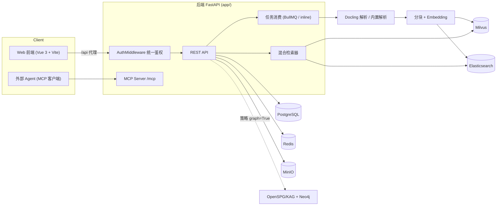

<div align="center">


### 让每一条知识，皆可循脉而达

**基于 [LlamaIndex](https://github.com/run-llama/llama_index) 的企业级 RAG 知识库平台**
**文档解析 · 混合检索 · 知识图谱 · Agent 直连**

[](https://www.python.org)
[](https://fastapi.tiangolo.com)
[](https://github.com/run-llama/llama_index)
[](https://vuejs.org)
[](https://milvus.io)
[](https://www.elastic.co)
[](https://modelcontextprotocol.io)
[](https://docs.docker.com/compose)

[功能特性](#-功能特性) · [系统架构](#-系统架构) · [快速开始](#-快速开始) · [服务说明](#-docker-服务说明) · [配置说明](#-配置说明) · [License](#-license)

</div>

---

<br>

## ✨ 功能特性

- **多租户协作** — 团队 / 项目 / 知识库三级结构，账号体系 + 细粒度成员权限
- **文档处理流水线** — MinIO 对象存储 + BullMQ 任务队列（重试 / 指数退避 / 失败保留），支持 [Docling](https://github.com/DS4SD/docling) 解析（含 OCR）与内置解析策略
- **混合检索** — Milvus 向量检索（bge-m3，1024 维）× Elasticsearch 全文检索（每库一索引），支持 Rerank 重排序
- **知识图谱（可选）** — 基于 [OpenSPG / KAG](https://github.com/OpenSPG/KAG) 构建图谱，检索策略按知识库自由切换
- **MCP Server** — 内置 MCP 服务（`POST /mcp`），将知识库检索作为工具直连 Claude / Cursor 等任意 Agent
- **安全** — JWT 双 Token（AT 滑动续期 + RT 双生命周期）、RSA 加密传输密码、登录防暴力破解、统一鉴权中间件
- **可观测** — OpenTelemetry 全链路埋点，结构化日志（trace_id 注入 + 按天滚动清理）

## 🏗️ 系统架构



## 🧱 技术栈

| 层 | 技术 |
|---|---|
| 后端 | Python 3.11 · FastAPI · LlamaIndex · SQLAlchemy 2 (asyncpg) |
| 前端 | Vue 3 · TypeScript · Vite · Tailwind CSS 4 |
| 检索 | Milvus (向量) · Elasticsearch (全文) · OpenAI 兼容协议模型服务 |
| 基础设施 | PostgreSQL · Redis · MinIO · BullMQ · OpenTelemetry |
| 可选 | Docling (文档解析) · OpenSPG/KAG + Neo4j (知识图谱) |

## 📁 目录结构

```
├── app/                    # FastAPI 后端
│   ├── main.py             # 应用入口（uvicorn :8000）
│   ├── api/                # 路由层（auth / team / document / retriever / provider）
│   ├── modules/            # 业务模块（auth / team / document / retriever / provider / task）
│   ├── core/               # 异常、依赖、日志
│   ├── config/             # pydantic-settings 配置
│   ├── db/                 # PostgreSQL ORM + Alembic + 向量库封装
│   ├── scripts/            # 初始化脚本 / KAG 安装脚本
│   ├── mcp_server.py       # MCP Server（对外暴露知识库检索工具）
│   └── requirements.txt
├── web/                    # Vue 3 前端（详见 web/README.md）
├── docker-compose.yml      # 本地基础设施一键启动
└── .env.example            # 环境配置模板（app/.env.example 为后端完整模板）
```

## 🚀 快速开始

### 前置要求

- Docker & Docker Compose
- Python 3.11+
- Node.js 18+

### 1 · 启动基础设施

```bash
docker compose up -d
```

会启动：PostgreSQL、Redis、MinIO、Elasticsearch、Milvus（含 etcd）。

文档解析服务 Docling 镜像较大（约 2.2 GB），按需启动：

```bash
docker compose --profile docling up -d
```

### 2 · 启动后端

```bash
cd app
python -m venv .venv && source .venv/bin/activate
pip install -r requirements.txt

# 配置：复制模板为 .env.dev（settings 默认加载 .env.dev）
cp .env.example .env.dev
# 按需修改数据库连接、模型服务地址等

# 初始化建表 + 预置演示账号 + 模型提供商目录
python scripts/init_data.py

# 启动（0.0.0.0:8000）
python main.py
```

可选 —— 知识图谱能力（OpenSPG/KAG，依赖需单独安装，见 [scripts/install_kag.sh](app/scripts/install_kag.sh)）：

```bash
bash scripts/install_kag.sh
```

### 3 · 启动前端

```bash
cd web
npm install
npm run dev
```

访问 <http://localhost:5173>（前端将 `/api` 代理到后端 `:8000`）。

使用演示账号登录：`demo / demo123`（仅用于本地联调，生产环境禁用）。

## 🐳 Docker 服务说明

| 服务 | 端口 | 说明 |
|---|---|---|
| postgres | 5432 | 业务主库 |
| redis | 6379 | 会话 / 任务队列（BullMQ） |
| minio | 9000 / 9001 | 文档对象存储（9001 为控制台） |
| elasticsearch | 9200 | 分块全文检索（单节点，未启用认证） |
| etcd / milvus-minio | 内部 | Milvus standalone 依赖 |
| milvus | 19530 | 向量数据库 |
| docling-serve（profile: docling） | 5001 | 文档解析服务（含 OCR） |

> OpenSPG/KAG 使用[官方 Docker 部署](https://github.com/OpenSPG/KAG)单独启动，服务地址通过 `KAG_OPENSPG_URL` 配置。

## ⚙️ 配置说明

后端配置位于 `app/.env.{ENV}`（`ENV` 默认 `dev`），完整模板见 [app/.env.example](app/.env.example)，所有配置项均有带注释的默认值。常用项：

| 配置 | 说明 |
|---|---|
| `POSTGRESQL` | 数据库连接串 |
| `REDIS_URL` | Redis 连接；留空时任务队列降级为进程内执行（仅限本地开发） |
| `MILVUS_URI` / `ES_URL` | 检索存储地址 |
| `DOCLING_BASE_URL` | 文档解析服务地址 |
| `KAG_OPENSPG_URL` | 知识图谱引擎地址 |
| `JWT_SECRET` | 生产环境必须替换（≥32 字符）并通过配置中心下发 |
| `MINIO_*` | 对象存储地址与凭据 |

> [!WARNING]
> **生产环境注意**：`JWT_SECRET`、`PASSWORD_RSA_PRIVATE_KEY`（可用 `app/scripts/gen_rsa_keypair.py` 重新生成）、`MINIO_ACCESS_KEY/SECRET_KEY`、数据库口令等严禁使用开发默认值。

## 📄 License

暂未选定，请参见仓库 LICENSE 文件。
